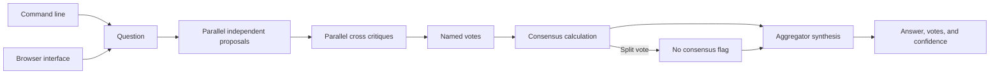

# Multi Agent Debate

Collect independent proposals, cross critiques, votes, and a synthesis with explicit consensus and confidence.

Proposals and critiques run concurrently. Set `consensus_threshold` to control when the result reports agreement; a split vote is marked as no consensus and synthesized with competing options.

## Quick start

Requires Python 3.11 or newer. From this repository:

```powershell
python -m venv .venv
.\.venv\Scripts\Activate.ps1
python -m pip install -e '.[dev]'
pytest -q
```

On macOS or Linux:

```bash
python3 -m venv .venv
source .venv/bin/activate
python -m pip install -e '.[dev]'
pytest -q
```

For live model calls, set `OPENAI_API_KEY` and optionally `OPENAI_MODEL` and `OPENAI_BASE_URL` as shown in `.env.example`. The test suite uses stubs and needs no model key.

The installed `agent-debate` command accepts at least two model IDs and a synthesis model. For example, `agent-debate --model model-a --model model-b --synthesizer-model model-c debate "Which database fits this workload?"` returns proposals, critiques, votes, a synthesis, and measured agreement as JSON. Replace the IDs with provider models configured for your OpenAI-compatible endpoint. Run the same prefix with `serve --port 8080` to use the local browser at `http://127.0.0.1:8080`. Agreement is not factual proof; review evidence before acting on the answer.

```python
from multi_agent_debate.engine import Debate
from multi_agent_debate.llm import OpenAICompatibleLLM

llm = OpenAICompatibleLLM.from_env()
result = Debate({"analyst": llm, "critic": llm, "planner": llm}, llm).run("Choose an API pagination strategy")
print(result.answer, result.votes, result.consensus)
```

## Architecture



| Component | Responsibility |
|---|---|
| Participants | Provide proposals, critiques, and one registered-name vote. |
| Consensus policy | Uses a configurable threshold and deterministic tie break. |
| Aggregator | Synthesizes competing arguments and surfaces uncertainty. |

Question -> independent proposals -> critique of alternatives -> bounded vote -> deterministic winner -> synthesis and reported consensus.

See [ARCHITECTURE.md](ARCHITECTURE.md) for components, state, failure behavior, and operations.

## Deployment and safety

See [DEPLOYMENT.md](DEPLOYMENT.md) for the non-root container, token-protected browser, data mounts, and release checks.

Model agreement is not independent factual verification. For higher diversity, configure different providers or prompts for each participant, and evaluate factual claims against external evidence.

Install this as a library in an authenticated application or worker. Supply the LLM adapter through dependency injection. Keep secrets in environment variables, never in source control.

## Verification

`pytest -q` runs deterministic tests. GitHub Actions runs the same suite on pushes and pull requests.

## License

MIT. See [LICENSE](LICENSE).
