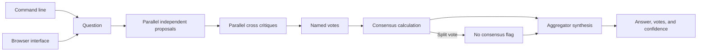
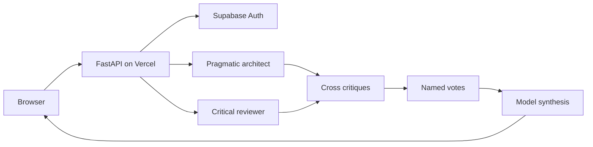

# Multi Agent Debate

## About

This app helps you compare possible answers to a hard question. Two agents propose a way forward, critique the alternatives, and vote. A final model then summarizes the strongest option and the remaining disagreements. You can read the proposals and critiques yourself instead of seeing only one polished answer.

### What you can do

- Ask a question and compare two role-specific proposals.
- See how each agent critiques the other option and where each vote went.
- Read a synthesis that reports whether the votes reached consensus.
- Use the [hosted app](https://multi-agent-debate-one.vercel.app/), CLI, local browser, or Python library.

The hosted app has email and password sign-in and does not save debate content. It is a limited pilot on a free model account, so live debates can hit provider rate limits. The two roles currently use different prompts on the same underlying model. Their agreement is a measure of vote share, not independent proof that the answer is true.

## Quick start

Requires Python 3.11 or newer. From this repository:

```powershell
python -m venv .venv
.\.venv\Scripts\Activate.ps1
python -m pip install -e '.[dev]'
pytest -q
```

On macOS or Linux:

```bash
python3 -m venv .venv
source .venv/bin/activate
python -m pip install -e '.[dev]'
pytest -q
```

For live model calls, set `OPENAI_API_KEY` and optionally `OPENAI_MODEL` and `OPENAI_BASE_URL` as shown in `.env.example`. The test suite uses stubs and needs no model key.

The installed `agent-debate` command accepts at least two model IDs and a synthesis model. For example, `agent-debate --model model-a --model model-b --synthesizer-model model-c debate "Which database fits this workload?"` returns proposals, critiques, votes, a synthesis, and measured agreement as JSON. Replace the IDs with provider models configured for your OpenAI-compatible endpoint. Run the same prefix with `serve --port 8080` to use the local browser at `http://127.0.0.1:8080`. Agreement is not factual proof; review evidence before acting on the answer.

```python
from multi_agent_debate.engine import Debate
from multi_agent_debate.llm import OpenAICompatibleLLM

llm = OpenAICompatibleLLM.from_env()
result = Debate({"analyst": llm, "critic": llm, "planner": llm}, llm).run(
    "Choose an API pagination strategy"
)
print(result.answer, result.votes, result.consensus)
```

## Architecture



Hosted path:



| Component | Responsibility |
|---|---|
| Participants | Provide proposals, critiques, and one registered-name vote. |
| Consensus policy | Uses a configurable threshold and deterministic tie break. |
| Aggregator | Synthesizes competing arguments and surfaces uncertainty. |

Question -> independent proposals -> critique of alternatives -> bounded vote -> deterministic winner -> synthesis and reported consensus.

See [ARCHITECTURE.md](ARCHITECTURE.md) for components, state, failure behavior, and operations.

## Deployment and safety

See [DEPLOYMENT.md](DEPLOYMENT.md) for the non-root container, token-protected browser, data mounts, and release checks.

Model agreement is not independent factual verification. For higher diversity, configure different providers or prompts for each participant, and evaluate factual claims against external evidence.

Install this as a library in an authenticated application or worker. Supply the LLM adapter through dependency injection. Keep secrets in environment variables, never in source control.

## Verification

`pytest -q` runs deterministic tests. GitHub Actions runs the same suite on pushes and pull requests.
The hosted smoke test creates a temporary user, signs in, runs a real debate, and deletes the user afterward. See [DEPLOYMENT.md](DEPLOYMENT.md).

## Product guide

### Read a debate result

The output contains each participant's proposal, each critique, a vote from each participant, a winning proposal, a consensus fraction, and a final synthesis. A `consensus_reached` flag says whether the vote share crossed the configured threshold. With two participants, a split vote is reported as disagreement; the synthesis should present competing options rather than pretending there is agreement.

| Field | How to use it |
|---|---|
| `proposals` | Compare the original options before critiques influence the result. |
| `critiques` | Look for missing evidence, assumptions, and implementation risks. |
| `votes` and `winner` | See the stated preference and deterministic tie break. |
| `consensus` and `confidence` | Understand agreement within this run, not factual truth. |
| `answer` | Read the synthesized recommendation together with the supporting debate. |

### Ways to run it

The hosted browser uses two role-specific prompts on one configured model: a pragmatic architect and a critical reviewer. It verifies the user's Supabase session and returns the debate without storing its content. The CLI can use two or more model IDs and a separate synthesis model, so an operator can test a more diverse configuration. The Python library accepts injected model clients and a configurable consensus threshold.

For a useful question, include the decision, constraints, and the tradeoff you care about. “Choose pagination for a feed that changes every minute and must support stable cursors” gives the participants more to assess than “What database is best?” Inspect their arguments before treating the synthesis as advice.

### Capacity, privacy, and limits

Set `OPENAI_API_KEY`, `OPENAI_BASE_URL`, and `OPENAI_MODEL` for the hosted model. Supabase sign-in uses `SUPABASE_URL` and `SUPABASE_PUBLISHABLE_KEY`. The hosted path makes five model requests for a two-participant debate; the current free provider account can return rate-limit errors under load. Debates are not saved by the app, but their prompts and intermediate arguments are sent to the configured model provider. Avoid secrets or sensitive personal information unless the provider and your deployment policy permit them.

Run `scripts/smoke_hosted.py` to verify sign-in, a real debate, and sign-out with a temporary user. CI tests the vote and consensus logic without model calls. See [DEPLOYMENT.md](DEPLOYMENT.md) for the hosting boundary and [ARCHITECTURE.md](ARCHITECTURE.md) for the stage-by-stage design.

### Common issues

| Symptom | Check |
|---|---|
| The hosted app returns a rate limit | A debate uses several model calls; wait for the provider window or provision more capacity. |
| Votes are split | Read both proposals and critiques; a tie is intentionally marked as no consensus. |
| A vote is malformed | The engine falls back to the participant's own proposal rather than inventing a vote. |
| The synthesis sounds certain despite weak evidence | Use the recorded proposals and critiques for human review; consensus is not factual validation. |

For regulated or high-stakes decisions, add external evidence gathering and approval outside this product. The debate is a structured comparison aid, not an autonomous decision authority.

## License

MIT. See [LICENSE](LICENSE).
